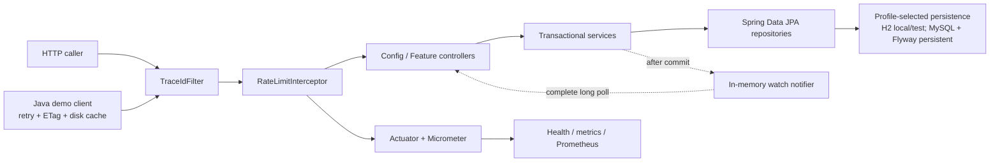

# config-center

`config-center` is a Java 17 and Spring Boot configuration center with versioned writes, rollback, Feature Flag evaluation, and a resilient Java CLI. The local walkthrough shows configuration reads with ETag, namespace Watch, and how a feature decision is explained. H2 provides a zero-dependency local start. MySQL and Flyway provide versioned persistent storage.

## Repository capabilities

- Configuration upsert and reads by `app + env + key`
- Append-only configuration history with bounded reverse-chronological reads and rollback as a new business version
- Feature Flag upsert, bounded history reads, rollback, allowlist, and stable percentage rollout
- `ETag` / `If-None-Match` configuration reads with HTTP 304
- Long-poll configuration watch based on a persistent `app + env` namespace revision
- API Key authorization for configuration and Feature Flag writes
- Optimistic-lock conflict handling and consistent HTTP error statuses
- Java CLI client with retry, circuit breaking, ETag cache, transient-failure fallback, and watch refresh
- Trace IDs, rate limiting, Actuator, Micrometer/Prometheus, JaCoCo, and CI verification

## Architecture



## Prerequisites and build

- JDK 17
- Internet access on the first wrapper run so Maven 3.9.16 can be downloaded
- Docker Desktop with Docker Compose only for the persistent startup path
- MySQL 8.0 or later only when running the manually managed persistent profile

Windows PowerShell:

```powershell
.\mvnw.cmd -q -B clean verify
```

Unix-like shell:

```bash
./mvnw -q -B clean verify
```

The build runs both modules' tests and generates JaCoCo reports under:

- `config-center-server/target/site/jacoco/index.html`
- `config-center-client/target/site/jacoco/index.html`

See [current verification](docs/project/CURRENT_STATE.md) for the tested build and environment.

## Quick start: H2

After the build, start the executable server jar:

```powershell
java -jar config-center-server/target/config-center-server-1.0.0.jar --spring.profiles.active=local
```

Omitting `spring.profiles.active` also selects `local`. Automated server tests activate the isolated `test` profile.
Direct local and MySQL JAR processes listen on `127.0.0.1` by default through `SERVER_ADDRESS`; change that process-level address only when a different direct-runtime boundary is intended.

For the deterministic request sequence below, disable only the local rate limiter while keeping all application behavior under demonstration:

```powershell
java -jar config-center-server/target/config-center-server-1.0.0.jar --spring.profiles.active=local --rate-limit.enabled=false
```

The default port is `8080`. Important local endpoints:

- Swagger UI: `http://localhost:8080/swagger-ui/index.html`
- H2 Console: `http://localhost:8080/h2-console`
- Health: `http://localhost:8080/actuator/health`
- Metrics: `http://localhost:8080/actuator/metrics`
- Prometheus: `http://localhost:8080/actuator/prometheus`

## Persistent start: MySQL + Docker Compose

Create a local environment file and replace every `replace-with-...` value with project-only development credentials. Do not reuse production passwords or API Keys; `.env` is ignored by Git.

```powershell
Copy-Item .env.example .env
docker compose up -d --build
docker compose ps
```

Compose starts only `mysql` and `config-center-server`. MySQL 8.4 stores data in the named volume `config-center_mysql-data` and is not exposed on the host; the server waits for MySQL to become healthy and is then available at `http://127.0.0.1:${SERVER_PORT:-8080}` by default. Compose sets the server process `SERVER_ADDRESS=0.0.0.0` inside its network namespace, while `SERVER_BIND_ADDRESS` controls the host publication and defaults to `127.0.0.1`; set the latter explicitly in the ignored `.env` only when access from another host interface is intended.

Useful diagnostics:

```powershell
docker compose logs --no-color config-center-server
docker compose logs --no-color mysql
```

`docker compose down` removes containers and the network but preserves MySQL data. `docker compose down -v` also deletes the named volume; use it only when an intentional reset of local development data is authorized. The next startup creates an empty database and reapplies all Flyway migrations, currently V1 through V3.

For a manually managed empty MySQL database, grant a dedicated non-root account access to the schema, set the required values, and select `mysql`:

```powershell
$env:CONFIG_CENTER_DB_URL = "jdbc:mysql://localhost:3306/config_center?useUnicode=true&characterEncoding=utf8&serverTimezone=Asia/Shanghai&useSSL=false&allowPublicKeyRetrieval=true"
$env:CONFIG_CENTER_DB_USERNAME = "config_center_app"
$env:CONFIG_CENTER_DB_PASSWORD = "replace-with-local-password"
$env:CONFIG_CENTER_API_KEY = "replace-with-local-api-key"
java -jar config-center-server/target/config-center-server-1.0.0.jar --spring.profiles.active=mysql
```

On MySQL, Flyway creates the V1 schema, applies V2 history-version uniqueness constraints and widens both history reason columns in V3. Hibernate then validates the schema. The MySQL profile requires a nonblank `CONFIG_CENTER_API_KEY`.

Migration files are under `config-center-server/src/main/resources/db/migration/`. `V1__init_schema.sql` is the immutable baseline; `V2__add_history_version_unique_constraints.sql` makes each history business key and version unique. `V3__widen_rollback_history_reasons.sql` widens both nullable history reasons to `VARCHAR(600)`. Start future migrations at V4 and preserve all applied scripts. Confirm the applied/unchanged migration from the server log:

```powershell
docker compose logs --no-color config-center-server | Select-String "Migrating schema|up to date"
```

If host port `8080` is occupied, set `SERVER_PORT=8081` (or another free port) in `.env` before `docker compose up`. The default `SERVER_BIND_ADDRESS=127.0.0.1` keeps the server local-only; change it explicitly only when another host interface is required. MySQL deliberately has no host-port mapping in the persistent Compose path, so it does not contend for local port `3306`.

To run the isolated MySQL regression locally, start only the dedicated test database, export credentials matching `MYSQL_USER` and `MYSQL_PASSWORD` in the ignored `.env`, then activate the Maven profile:

```powershell
docker compose -p config-center-it -f compose.yml -f compose.mysql-it.yml up -d --wait mysql
$env:CONFIG_CENTER_DB_URL = "jdbc:mysql://127.0.0.1:33306/config_center_it?useUnicode=true&characterEncoding=utf8&serverTimezone=Asia/Shanghai&useSSL=false&allowPublicKeyRetrieval=true"
$env:CONFIG_CENTER_DB_USERNAME = "replace-with-MYSQL_USER"
$env:CONFIG_CENTER_DB_PASSWORD = "replace-with-MYSQL_PASSWORD"
$env:CONFIG_CENTER_API_KEY = "replace-with-MYSQL_API_KEY"
.\mvnw.cmd -q -B -Pmysql-it verify
docker compose -p config-center-it -f compose.yml -f compose.mysql-it.yml down -v
```

The `mysql-it` profile exclusively uses the disposable `config_center_it` schema. Failsafe runs persistence checks and a populated V2-to-V3 upgrade. The upgrade fixture rebuilds the five application tables and Flyway history. See the [upgrade and build rollback procedure](docs/project/RUNBOOK.md#v3-升级与构建回退). The normal `clean verify` remains H2-only and does not require Docker.

## Local walkthrough

The following PowerShell sequence assumes a freshly started server using the deterministic command above. The default development API Key authorizes configuration and Feature Flag writes for `demo-app/dev`. Set `CONFIG_CENTER_API_KEY` before starting the server to replace the default key.

```powershell
$base = "http://localhost:8080"
$writeHeaders = @{ "X-API-Key" = "kr-dev-key" }

$configBody = @{
  app = "demo-app"
  env = "dev"
  key = "db.pool.size"
  value = "10"
  description = "pool size"
  operator = "demo"
  reason = "local verification"
} | ConvertTo-Json

$config = Invoke-RestMethod -Method Post `
  -Uri "$base/api/configs" `
  -Headers $writeHeaders `
  -ContentType "application/json" `
  -Body $configBody

$list = Invoke-WebRequest -Uri "$base/api/configs?app=demo-app&env=dev"
$etag = $list.Headers["ETag"]
try {
  $notModified = (Invoke-WebRequest `
    -Uri "$base/api/configs?app=demo-app&env=dev" `
    -Headers @{ "If-None-Match" = $etag }).StatusCode
} catch {
  $notModified = [int]$_.Exception.Response.StatusCode
}

$featureBody = @{
  app = "demo-app"
  env = "dev"
  name = "new-checkout"
  enabled = $true
  rolloutPercentage = 30
  allowlist = @("u1000", "u2000", "a+b")
  operator = "demo"
  reason = "local verification"
} | ConvertTo-Json

$feature = Invoke-RestMethod -Method Post `
  -Uri "$base/api/features" `
  -Headers $writeHeaders `
  -ContentType "application/json" `
  -Body $featureBody

$evaluation = Invoke-RestMethod `
  -Uri "$base/api/features/evaluate?app=demo-app&env=dev&name=new-checkout&userId=u1000"
$watch = Invoke-RestMethod `
  -Uri "$base/api/configs/watch?app=demo-app&env=dev&sinceVersion=0&timeoutSeconds=1"

$config.data | Select-Object key, value, version
$notModified
$feature.data | Select-Object name, enabled, version
$evaluation.data | Select-Object userId, enabled, decision
$watch.data | Select-Object changed, latestVersion
```

Expected stable fields from a fresh server:

```text
key=db.pool.size, value=10, version=1
304
name=new-checkout, enabled=True, version=1
userId=u1000, enabled=True, decision=allowlist 命中
changed=True, latestVersion=1
```

`traceId`, timestamps, and the ETag hash are intentionally omitted because they vary by request or data state.

## Run the demo client

After seeding the configuration and Feature Flag above, run the client once without long polling:

```powershell
.\mvnw.cmd -q -B -pl config-center-client spring-boot:run '-Dspring-boot.run.arguments=--demo.watch.enabled=false'
```

Remove the argument to use the configured five Watch rounds. A normal no-change poll or a completed configuration confirmation finishes one round. Each round can recover from temporary failures, including the last one. The final `cacheHit` and `etag304` counts include the initial read, verified 304 responses and stale fallbacks during Watch. The client cache is stored at `${user.home}/.config-center-client-cache.json`; an existing legacy `.config-center-demo-client-cache.json` is migrated without being deleted only when the canonical file is absent. A present empty or malformed canonical cache does not revive legacy data.

The client retries 5xx and network failures and may use a structurally valid cached configuration only after those transient attempts are exhausted. A cache entry is valid only when its body is a configuration response with integral `code: 0` and array `data`; malformed entries neither send an ETag nor satisfy a 304 response or fallback. HTTP 4xx responses, including 429, neither retry nor open the availability circuit breaker and never return stale cache as success; requests rejected by an already-open breaker also do not fall back.

Fresh HTTP 200 responses must contain integral `code: 0` and non-null `data`. Configuration data must be an array, while Watch data requires boolean `changed` and a non-negative integral `latestVersion`. A cached body with a missing or unusable ETag remains eligible for transient-failure fallback and sends an unconditional request. Accepting 304 requires a valid cached body and its concrete validator on the request. An ETag returned with the 304 must weakly match that validator. Malformed successful responses are protocol errors. Cache writes use a completed file in the same directory and atomic replacement when supported. The CLI encodes query values once. With the walkthrough data, `--demo.userId=a+b` gives the same allowlist decision as a direct HTTP request using `userId=a%2Bb`.

### Watch recovery

If the service reports a change while the configuration read is failing, the CLI can show the old cached value and keep the update pending. When reads work again, it fetches directly and applies the result even if the service has received no further writes.

The session subscribes from 0 and reads again after its first valid Watch observation, including an empty namespace at revision 0. `observedRevision` reports what Watch saw. `confirmedCursor` advances only after a valid list 200 or a verified 304, up to the revision observed before the read. A smaller observed revision also triggers a read and can reset the cursor. Watch timeouts report the revision captured during registration. A database rebuild that catches up to the old cursor can look like normal progress.

The recovery window starts on the first recoverable failure in a logical round. It includes later failures, stale fallbacks and open-breaker refusals. The default is 30 seconds to start new recovery calls, with at least 1 second between failed calls and the next attempt. An in-flight call may finish its internal retries and timeouts after that window, or confirm on success unless the thread was cancelled. Budget exhaustion, terminal HTTP or protocol errors, and cancellation end the Watch session with a nonzero exit. The final status includes the confirmed cursor, pending sync status and end reason. [Reproduce recovery, H2 restart and budget exhaustion](docs/project/RUNBOOK.md#config-plan04-watch-演练)

## Concurrent writes and lost responses

If two writes start from the same version, the losing write returns HTTP 409. Read the current row and history before choosing whether to submit a new write. `expectedVersion` checks an existing row. Creating a missing row and updating without a version condition remain supported. Configuration writes commit the current row, history and namespace revision together, and Watch signals after commit.

A lost connection after saving leaves the result uncertain. Use a new connection to read the current value and history. History can show that the intended value was saved even when a later write replaced it. Attributing that saved value to one request requires a durable request identity.

The MySQL name comparison can match case, accent and trailing-space variants that the exact Java authorization and Watch keys treat as different. This can delay a waiting Watch until its next poll and can change rollout buckets when the requested flag name changes. [MySQL and H2 evidence and pending decisions](docs/project/WRITE_CONSISTENCY.md) · [Reproduce the concurrency and lost-response scenarios](docs/project/RUNBOOK.md#config-plan05-并发与结果读回)

## Public API

| Method | Path | Write authorization | Purpose |
| --- | --- | --- | --- |
| `GET` | `/api/ping` | none | Liveness-style application response |
| `POST` | `/api/configs` | `X-API-Key` | Create or update a configuration |
| `GET` | `/api/configs` | none | List configurations; supports `If-None-Match` |
| `GET` | `/api/configs/{key}` | none | Read one configuration |
| `GET` | `/api/configs/history` | none | Read bounded configuration history |
| `POST` | `/api/configs/rollback` | `X-API-Key` | Restore a snapshot as a new version |
| `GET` | `/api/configs/watch` | none | Long-poll a namespace revision |
| `POST` | `/api/features` | `X-API-Key` | Create or update a Feature Flag |
| `GET` | `/api/features` | none | List Feature Flags |
| `GET` | `/api/features/evaluate` | none | Evaluate one user; `userId` must be nonblank and at most 200 characters |
| `GET` | `/api/features/history` | none | Read bounded Feature Flag history |
| `POST` | `/api/features/rollback` | `X-API-Key` | Restore a Feature Flag snapshot as a new version |

All normal JSON responses use `code`, `message`, `data`, and `traceId`. Matching entity tags and a standalone `If-None-Match: *` return HTTP 304 with ETag, trace ID and an empty body for both empty and populated configuration lists. See `examples.http` for ready-to-run requests.

History reads return newest business versions first and keep the existing list response envelope. Both history endpoints default to the newest 50 snapshots; `limit` accepts `1..200`, and an optional positive `beforeVersion` is an exclusive business-version cursor. To read the next page, use the smallest `version` from the current page as `beforeVersion`. Calls that previously omitted pagination now receive at most 50 snapshots rather than the complete history.

Configuration-list data and its weak ETag are generated from one ordered in-memory snapshot. The hash uses an unambiguous length-prefixed encoding of every response item field, so reset business versions cannot hide changed values or descriptions.

Configuration watch requires `sinceVersion >= 0` and `timeoutSeconds` within `1..60`. Each completed long-poll response preserves its own request trace ID in both the `X-Trace-Id` header and JSON body, including timeout and write-triggered notification paths. Pending watch requests are bounded per server process: the global and per-namespace limits reject excess requests with the standard HTTP 429/code `4290` error envelope instead of allocating another waiter.

Within one server process, concurrent first writes to different keys in the same `app + env` namespace are serialized through a bounded 64-stripe lock, so both writes commit with distinct history rows and a monotonic namespace revision.

Write requests validate string lengths and require positive expected and rollback target versions when supplied. Rollback reasons allow up to 500 UTF-16 code units. Both histories retain the target-version prefix and full input, up to 533 code units. Feature Flag allowlists accept at most 20 non-blank entries of 32 characters each. Invalid bodies or query types return HTTP 400/code `4001`. Unexpected server failures return code `5000` and `系统异常`. Diagnostic details and the stack trace are logged with the response trace ID.

The local rate limiter groups requests by source address, HTTP method, and matched route pattern, with an access-order bucket cap to bound memory use. Micrometer exposes the monotonic FunctionCounter as `config_center_rate_limit_blocked`; Prometheus renders the counter sample as `config_center_rate_limit_blocked_total`. Watch metrics expose current pending waiters and active namespaces as `config_center_watch_pending` and `config_center_watch_namespaces`, while the monotonic rejection FunctionCounter `config_center_watch_rejected` is rendered by Prometheus as `config_center_watch_rejected_total`.

## Main configuration

| Setting | Default | Meaning |
| --- | --- | --- |
| `server.port` | `8080` | Server HTTP port |
| `server.address` / `SERVER_ADDRESS` | `127.0.0.1` | Direct JAR process listening address; Compose overrides it to `0.0.0.0` only inside the container |
| `SERVER_BIND_ADDRESS` (Compose) | `127.0.0.1` | Host address for the published container port; distinct from `SERVER_ADDRESS` |
| `spring.profiles.default` | `local` | Uses the zero-dependency H2 development profile when no profile is selected |
| `spring.datasource.url` (`local`) | in-memory H2 | Local persistence; data is lost when the process ends |
| `CONFIG_CENTER_DB_URL` / `CONFIG_CENTER_DB_USERNAME` / `CONFIG_CENTER_DB_PASSWORD` (`mysql`) | none | Required MySQL connection settings; startup fails when any value is missing |
| `rate-limit.enabled` | `true` | Enables per-process API rate limiting |
| `rate-limit.capacity` | `5` | Initial token-bucket capacity |
| `rate-limit.refill-per-second` | `5` | Token refill rate |
| `rate-limit.max-buckets` | `256` | Maximum process-local rate-limit buckets; least-recently-used entries are evicted |
| `config-watch.max-pending-waiters` | `256` | Maximum pending Watch requests in one server process |
| `config-watch.max-pending-per-namespace` | `64` | Maximum pending Watch requests for one `app/env` namespace |
| `security.api-keys` | one local/test `demo-app/dev` key | Configuration and Feature Flag write authorization mappings; MySQL requires nonblank `CONFIG_CENTER_API_KEY` and does not use the development fallback |
| `demo.http.*` | `800/3000 ms` | Client connect/read timeouts |
| `demo.watch.timeoutSeconds` / `demo.watch.readTimeoutMarginMs` | `10 s` / `2000 ms` | Long-poll timeout and extra client read margin |
| `demo.watch.rounds` | `5` | Maximum completed logical rounds. Set 0 for the one-shot read and feature evaluation |
| `demo.watch.recoveryTimeoutSeconds` / `demo.watch.recoveryRetryIntervalMs` | `30 s` / `1000 ms` | Recovery scheduling window and minimum retry interval. Both must be positive and convertible to nanoseconds |

## Known limits

- The `local` profile uses in-memory H2 and Hibernate `ddl-auto=update`. The persistent Compose path and MySQL integration job each use a single MySQL version and a single server process; there is no database-version matrix.
- Persistent data is a local Docker named volume, not a backup or production migration strategy. `down -v` intentionally destroys that development data and rebuilds an empty schema through Flyway.
- The configured API Key is plaintext and intended only for local learning; it is not a replacement for secret management or user authentication.
- Rate-limit buckets and long-poll waiters are process-local; multiple server instances do not coordinate them.
- The client is a demonstration CLI, not a published SDK, and its Java package still uses the legacy name `com.example.democlient`.
- The cache is a user-home JSON file without encryption or cross-process locking.
- There is no RBAC, multi-tenancy, frontend administration UI, or distributed deployment support.

## Project documentation

- [Architecture map](docs/project-map.md) and [example requests](examples.http)
- [Current verification](docs/project/CURRENT_STATE.md) and [runbook](docs/project/RUNBOOK.md)
- [Maintainer entry point](AGENTS.md) and [documentation index](docs/project/SUPPORTING_DOCS_MANIFEST.md)
- [GPT Project setup](docs/项目源文件/00-START_HERE.md) and [proposed upgrade roadmap](docs/项目源文件/UPGRADE_ROADMAP.md)
